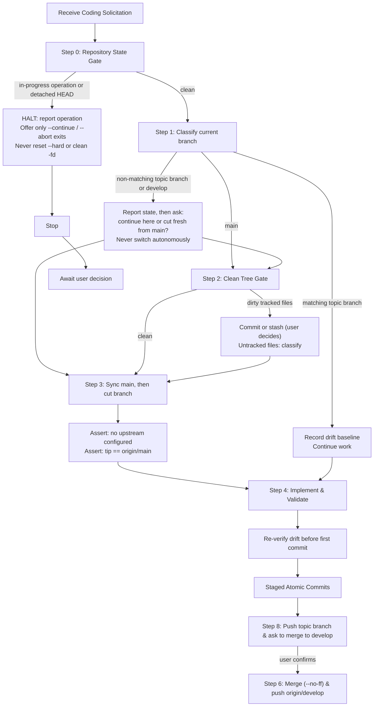

# Git Branching Strategy & Lifecycle Workflow

## Purpose

Enforce disciplined, trunk-based branch management across `rb-website`. All coding solicitations execute on short-lived, canonical topic branches cut from a **verified-synchronized local `main`**, push to `origin/<prefix>/<slug>` when validated, integrate into **`develop`** upon user confirmation, and promote to **`main`** via upstream pull requests.

**This file is the single procedural source of truth.** Rationale and policy live in [docs/branching-strategy.md](../../../docs/branching-strategy.md).

---

## The Golden Rules

1. **Never edit, commit, or push directly on `main`** — with exactly one named exception: the emergency hotfix backport in Step 7. That exception is enumerated and is the only sanctioned exit to `main`.
2. **Synchronize local `main`, then branch from it.** Never cut a topic branch directly from `origin/main` or `develop` (unless explicitly instructed by the user). Run `git fetch` + `git merge --ff-only` into local `main` first, then branch from local `main` (Step 3).
3. **A topic branch must never track `main` or `develop`.** After creating a branch, verify that `<branch>@{upstream}` does not resolve. A branch tracking `origin/main` can be published to `main` by `git push` under `push.default=upstream`, by `git push origin HEAD:main`, or by any editor or tool that resolves upstreams.
4. **Clean tree gate**: never switch branches with uncommitted *tracked* modifications. Untracked files are classified, not blocked (Step 2).
5. **Sync from `main` via pull, never rebase or force-push**: bring upstream `main` changes onto a topic branch via `git pull --no-rebase origin main` (Step 5). Never rebase a topic branch, never force-push (`--force`, `--force-with-lease`), and never merge `develop` into a topic branch.
6. **`develop` integration requires confirmation**: mature topic branches merge into `develop` via `git merge --no-ff <branch>` and push to `origin/develop` only upon user confirmation or explicit ask (Step 6). Direct commits on `develop` are prohibited unless explicitly requested by the user (which also push to `origin/develop`).
7. **Automatic topic push & conditional PR guidance**: once the staged commit pipeline and validation gates pass on a topic branch, automatically push (`git push -u origin <prefix>/<slug>`) and ask whether to merge into `develop` (Step 8). Do not emit PR guidance for routine topic completion; generate PR details only when a PR is explicitly requested.

---

## Execution Workflow



---

## Step 0: Repository State Gate (Mandatory, Before Any File Edit)

An unfinished git operation is not "a dirty tree". It is an in-progress state machine with its own recovery semantics, and `git reset --hard` / `git clean -fd` will destroy it.

### Step 0.1: Detect In-Progress Operations

```bash
git rev-parse --abbrev-ref HEAD   # empty output means detached HEAD
git status                        # first line names the operation, if any
ls .git | grep -E '^(rebase-merge|rebase-apply|MERGE_HEAD|CHERRY_PICK_HEAD|REVERT_HEAD|BISECT_LOG)$'
```

| Signal | Meaning |
| :--- | :--- |
| empty `git rev-parse --abbrev-ref HEAD` | Detached HEAD |
| `.git/rebase-merge/` or `.git/rebase-apply/` | Rebase in progress |
| `.git/MERGE_HEAD` | Merge in progress |
| `.git/CHERRY_PICK_HEAD` | Cherry-pick in progress |
| `.git/REVERT_HEAD` | Revert in progress |
| `.git/BISECT_LOG` | Bisect in progress |

### Step 0.2: Halt With a State-Read Menu

If any signal is present, **stop immediately**. Report the operation type and the affected files, then present **only** non-destructive exits:

| Operation | Offer |
| :--- | :--- |
| Rebase | `git rebase --continue`, `git rebase --skip`, `git rebase --abort` |
| Merge | `git merge --continue`, `git merge --abort` |
| Cherry-pick | `git cherry-pick --continue`, `git cherry-pick --abort` |
| Revert | `git revert --continue`, `git revert --abort` |
| Bisect | `git bisect reset` |
| Detached HEAD | `git switch <branch>` to return to a named branch |

**Never offer `git reset --hard` or `git clean -fd` while an operation is in progress.**
**Never run `--continue` or `--abort` on your own initiative.** The user chooses; the agent reports.

### Step 0.3: Audit for Tracked-Upstream Defects

```bash
pnpm git:check
```

Advisory. Reports non-canonical branch names and any topic branch tracking `main` or `develop`. Fix neither automatically.

---

## Step 1: Classify the Current Branch

Inspect with `git branch --show-current`, then `git status -s`.

### State A — On `main`

Proceed to Step 2.

### State B — On a Topic Branch Matching the Solicitation

Record the drift baseline and continue:

```bash
git rev-parse HEAD    # drift baseline for Step 4
```

### State C — On `develop` or a Non-Matching Topic Branch

**Do not switch branches on your own** (unless the user explicitly instructed cutting a fresh branch from `main`). Report state, then ask once:

```bash
git branch --show-current
git rev-list --count origin/main..HEAD
git log --oneline origin/main..HEAD | head -20
git status -s
```

Then ask: **continue on this branch, or cut a new one from `main`?**

- Uncommitted work always routes to Step 2 (stash/commit decision) before any switch.
- Switching is always an explicit, confirmed action.

---

## Step 2: Clean Working Tree Gate

Tracked modifications and untracked files are **different problems**. Handle them separately.

```bash
git status -s
git stash list
```

### Step 2.1: Tracked Modifications (Staged or Unstaged) — Hard Block

Never switch branches with these. The user chooses:

1. **Commit to the current branch** — finish the work via [conventional-commits](../conventional-commits/SKILL.md).
2. **Stash** — see the naming contract in Step 2.3.
3. **Keep the current branch** — if State B or State C resolved to "stay", no switch happens and the gate does not apply.

### Step 2.2: Untracked Files — Classify, Never Auto-Delete

List them and ask the user to classify each:

| Classification | Action |
| :--- | :--- |
| Part of the current work | Commit it on the current branch |
| Throwaway scratch | The **user** deletes it, naming the files explicitly |
| Local-only / environmental | Add the path to `.gitignore` |

**`git clean -fd` is not a menu option.**

### Step 2.3: Stash Is a Two-Way Contract

**Push** — always name the entry so it can be matched to a solicitation later:

```bash
git stash push -u -m "<prefix>/<slug>: <one-line reason>"
```

**Inventory** — run `git stash list` at pre-flight and again at handoff. Flag any entry whose branch no longer exists as orphaned work requiring a decision.

**Pop** — to resume stashed work:

```bash
git status -s
git stash pop
git stash list
```

---

## Step 3: Synchronize Local `main`, Then Cut the Topic Branch

**Never run `git checkout -b <slug> origin/main`.** That sets the branch's upstream to `origin/main` (Golden Rule 3).

```bash
# 1. Synchronize local main with the trunk
git fetch origin main
git checkout main
git merge --ff-only origin/main

# 2. Cut the topic branch from the now-verified local main
git checkout --no-track -b <prefix>/<slug> main
```

### Step 3.1: Handle Divergence as a Protective Failure

If `git merge --ff-only origin/main` fails, local `main` has commits that `origin/main` does not. **Halt. Never auto-reset local `main`.** Report:

```bash
git rev-list --left-right --count origin/main...main
git log --oneline origin/main..main
```

Ask the user to reconcile — push, reset, or cherry-pick.

### Step 3.2: Post-Conditions (Assert Both)

```bash
git rev-parse --abbrev-ref <prefix>/<slug>@{upstream}   # MUST fail: no upstream
[ "$(git rev-parse HEAD)" = "$(git rev-parse origin/main)" ] && echo "base OK" || echo "BASE MISMATCH"
```

The first must report no upstream configured. The second must print `base OK`. If either fails, stop and report.

### Canonical Prefix Taxonomy

| Prefix | Use When | Example |
| :--- | :--- | :--- |
| `feature/` | Adding a new capability, section, or page | `feature/blog-section` |
| `fix/` | Correcting a bug, layout flaw, or data error | `fix/navbar-mobile-overflow` |
| `chore/` | Tooling, dependency upgrades, agent/docs setup, config | `chore/setup-agents-and-docs` |
| `refactor/` | Structural code changes without functional modification | `refactor/experience-card-variants` |
| `docs/` | Documentation, ADR records, guides | `docs/design-system-alignment` |
| `test/` | Adding or updating unit or browser tests | `test/portfolio-smoke-e2e` |
| `perf/` | Performance optimizations, image/bundle tuning | `perf/hero-lcp-preload` |

Allowed non-topic branches: `main` (trunk) and `develop` (intermediate integration branch).

*Disallowed aliases*: `feat/`, `bugfix/`, `hotfix/`, `agent/`, `agents/`, `wip/`, `temp/`, `style/`, and any unlisted prefix. Run `pnpm git:check` to audit.

---

## Step 4: Implement, Validate, and Re-Verify Drift

Implement the change and run the validation gates defined in [conventional-commits](../conventional-commits/SKILL.md).

Before creating the **first** commit, re-verify against the Step 1 baseline:

```bash
git rev-parse HEAD
git status
```

HALT and report if the tip changed, a new in-progress operation appeared, or the branch no longer exists. Re-check again at Step 8.

---

## Step 5: In-Flight Synchronization (`git pull --no-rebase origin main`)

When `origin/main` advances mid-development, bring those changes onto the topic branch using a merge pull (`--no-rebase`) rather than rebasing. Never force-push (`--force`, `--force-with-lease`), and never merge `develop` into a topic branch.

First verify the branch has not already been merged into `origin/main`:

```bash
git fetch origin main
git merge-base --is-ancestor HEAD origin/main && echo "CONTAINED - HALT" || echo "safe to sync"
```

When safe, pull `origin/main` onto the topic branch via a standard merge commit:

```bash
git pull --no-rebase origin main
```

### Handling Merge Conflicts

1. Resolve the conflicting files (or halt and ask the user if non-trivial).
2. Stage them: `git add <resolved-files>`.
3. Complete the merge: `git commit --no-edit`.
4. Re-run validation gates after the merge completes.

---

## Step 6: Promote Mature Topic to `develop` (`--no-ff` & Push)

`develop` is the intermediate integration branch. When topic work is complete, validated, and pushed:

### Step 6.1: Assess and Confirm Maturity

- After pushing the validated topic branch (Step 8.3), ask the user:
  `"Should I merge <prefix>/<slug> into develop and push origin/develop?"`
- Alternatively, merge into `develop` upon explicit user command.
- **Never merge into `develop` or commit on `develop` autonomously** without user confirmation or explicit instruction.

### Step 6.2: Execute Non-Fast-Forward Merge & Push `develop`

```bash
git checkout develop
git pull --ff-only origin develop
git merge --no-ff <prefix>/<slug>
git push origin develop
```

No PR is required for this integration into `develop`, and no PR guidance is emitted for standard topic completion.

### Step 6.3: Merge Conflict Handling

If `git merge --no-ff` encounters conflicts, **halt immediately**. Report the conflicting files and offer `git merge --abort`.

---

## Step 7: Emergency Production Hotfix (Named Exception to Golden Rule 1)

Golden Rule 1 forbids committing on `main`. **This is the single sanctioned exception**, and all three conditions must hold:

1. The branch uses the canonical `fix/` prefix. Never invent `hotfix/`.
2. The branch is cut from a release tag or deployed commit.
3. The direct commit to `main` happens only **after** the hotfix branch is validated and merged.

```bash
git fetch --tags
git checkout -b fix/<topic> <release-tag-or-commit>
# implement minimal fix, run validation, commit per Conventional Commits

# Backport onto main:
git checkout main
git merge --ff-only origin/main
git cherry-pick <commit-hash>

# Back-merge fix onto develop to keep integration in sync:
git checkout develop
git merge --no-ff main
git push origin develop
```

---

## Step 8: Topic Push, `develop` Integration Prompt & On-Demand PR Details

When all staged atomic commits and validation gates pass on a topic branch:

### Step 8.1: Verify the Commit Set

```bash
git rev-parse HEAD
git log --oneline origin/main..HEAD
```

### Step 8.2: Surface Stash Inventory

```bash
git stash list --format='%gd | %s'
```

### Step 8.3: Push the Validated Topic Branch & Ask About `develop`

Automatically push the validated topic branch to `origin`:

```bash
git push -u origin <prefix>/<slug>
```

Then ask the user:
`"Should I merge <prefix>/<slug> into develop and push origin/develop?"`

Do **not** emit PR title/body guidance on normal topic branch completion.

### Step 8.4: Provide Pull Request Details (On-Demand Only)

Generate the PR title and body **only** when the user explicitly requests a PR (e.g. a Release PR from `develop` -> `main`, an urgent topic bypass PR to `main`, or via `/pr`):

- **Title**: `[<Prefix>] <Imperative description>` or `[Release] vX.Y.Z - <Highlights>` for `develop` release PRs.
- **Body**: Follow the canonical 5-section layout from [`pr`](../pr/SKILL.md) (`## Summary`, `## Evidence`, `## Merge Danger`, `## Verification Gates`, `## References`).
- **Target**: `main` for `develop` release PRs or urgent topic bypass PRs (when merged, absorb `main` into `develop` with `--no-ff`).

### Step 8.5: Post-Merge Cleanup

```bash
git checkout main
git merge --ff-only origin/main
git checkout develop
git merge --ff-only main 2>/dev/null || git merge --no-ff main
git push origin develop
git branch -d <prefix>/<slug>
git remote prune origin
```
