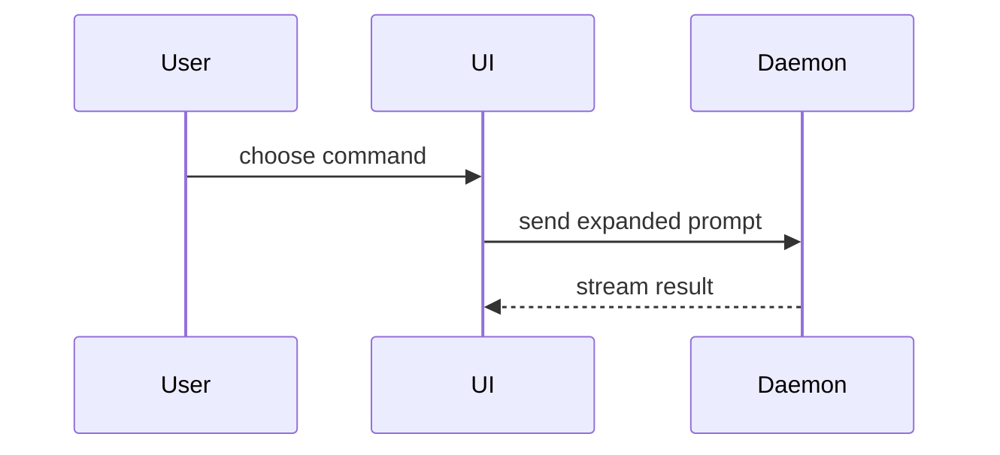

Use this skill when preparing pull request titles and descriptions.

## Pull Request Titles

PR titles strictly use bracketed canonical prefixes with sentence-cased imperative summaries, without trailing periods and without package scope tags:

```text
[<Prefix>] <Imperative description>
```

### Allowed Canonical Prefixes:

- `[Feature]` — New capability or endpoint (for `feature/*` branches)
- `[Fix]` — Bug fix or defect correction (for `fix/*` branches)
- `[Chore]` — Maintenance, codegen, or dependencies (for `chore/*` branches)
- `[Refactor]` — Structural refactoring without behavioral change (for `refactor/*` branches)
- `[Docs]` — Documentation and ADR updates (for `docs/*` branches)
- `[Test]` — Test suite additions and fixes (for `test/*` branches)
- `[Perf]` — Performance and memory optimizations (for `perf/*` branches)
- `[Release]` — Upstream release train (`develop` → `main`)

_Examples_:

- `[Feature] Implement benefit recharge schedules and destiny accounts`
- `[Fix] Prevent scroll reset on modal open`
- `[Release] v0.2.0 - Benefit recharge schedules and payroll sync`

---

## Topic PR Template

Use this template for standard topic pull requests:

```markdown
## Summary

<diagram, diff-sketch, or tree>

## Evidence

- **Before:** <screenshot/output/failing test run>
  **After:** <screenshot/output/passing test run>

## Merge Danger

**Door:** <one-way or two-way>

<optional: description>

**Blast Radius:** <one-word description>

<optional: potential ramifications of merge>

## Verification Gates

<!-- Check off all Dockerized gates that were executed and passed -->

- [ ] `docker compose run --rm api pnpm run test`
- [ ] `docker compose run --rm web pnpm run prettier`
- [ ] `docker compose run --rm web pnpm exec tsc --noEmit`
- [ ] `python3 scripts/check-docs.py`

## References

- Linear: <e.g., Refs RIC-123 or Closes RIC-123>
- ADR: <e.g., ADR YYYY-MM-DD-HH-mm-ss or N/A>
```

---

## Release PR Template (`develop` → `main`)

Before opening a release PR, ensure lockstep versions are bumped on `develop` (`pnpm run version:bump <minor|patch|x.y.z>`) and committed as `chore(release): bump version to vX.Y.Z`.

```markdown
## Release Highlights

<Concise summary of user-facing capabilities, architectural milestones, and performance improvements shipped in this release.>

## Included Changes

### Features

- <Feature 1>
- <Feature 2>

### Fixes

- <Fix 1>
- <Fix 2>

### Chores & Maintenance

- <Chore 1>

## Breaking Changes & Migrations

<Database schema migrations, newly required environment variables, or "None">

## Pre-Release Verification Checklist

- [ ] `node scripts/version.mjs check`
- [ ] `bash scripts/ci-gates.sh all`
- [ ] `docker compose run --rm api pnpm run migration:deploy`

## References

- Included ADRs: <list of recorded ADRs>
```

## Sections

Skip all preambles and keep prose brief. Use the user's domain language from `GLOSSARY.md`.

### Summary

Pick the smallest view that makes the key point clear.

- Show logic or an algorithm as pseudocode:

```text
on(save)
  if content is unchanged
    return cached result
  write new content
  return fresh result
```

- Show runtime control flow as a call tree:

```text
submitForm
  createSession
    persistPrompt
    launchAgent
  navigateToSession
```

- Show UI structure as a component tree, including state and module boundaries that matter:

```text
<SessionPage> (apps/example/src/routes/session.tsx)
  useSessionEvents()
  <SessionToolbar>
    <RunSkillButton> (packages/ui)
```

- Show file responsibility or a broad refactor as a shallow file tree:

```text
src/
├── commands/       # parses user actions
├── sessions/       # owns session state
└── transport/      # sends API requests
```

- Show component interaction, control flow, or data flow with Mermaid:



- Use `diff` when the point is what changes and the surrounding shape already exists. Match the diff shape to the topic.

For a component change:

```diff
 <SessionPage>
   useSessionEvents()
   <SessionToolbar>
+    <RunSkillButton />
   <SessionTimeline>
+    <SkillResultCard />
```

For a file-layout change:

```diff
 src/
 ├── commands/
+│   └── show-me.ts       # expands the slash command
 ├── sessions/
-└── transport.ts
+└── transport/
+    ├── client.ts
+    └── stream.ts
```

For a call-tree or call-stack change:

```diff
 submitForm
   createSession
     persistPrompt
+    expandSkillMention
     launchAgent
-  navigateToSession
+  navigateToSession
+    subscribeToEvents
```

For a state or control-flow change:

```diff
 on(save)
-  write content
+  if content is unchanged
+    return cached result
+  write new content
+  invalidate cache
```

- Show the whole block when most of it is new, when omitted context would hide ownership or order, or when the user needs a copyable target shape:

```ts
function expandSkill(command: string): string {
  const skillName = command.slice(1);
  return `use the ${skillName} skill`;
}
```

#### Guidance

Place each visual next to the short text it supports. Keep only the calls, files, props, states, and boundaries needed to answer the user's current question or the options to resolve the current discussion point.

You may use one of these, you may use several, it is unlikely you will use all of them. Use your judgement and don't overwhelm the user.

### Evidence

Concrete evidence that the change works. Show a before and after.

Screenshots are S-tier - when the environment is set up for it and the change is visual.

Execution-based evidence is A-tier. Test results, console output. Show the exact test that now fails and passes, using pseudocode.

### Merge Danger

Describe whether it's a one-way or two-way door. You can walk back through two-way doors, but not one-way doors. A PR that is cheap to roll back is lower risk. Changes that involve destructive actions or hard-to-reverse decisions are one-way doors.

The blast radius is the potential impact or scope of the changes introduced by this PR. Consider all possibilities. Examples are layout shift, breakages for consumers, mobile responsiveness, etc.

### Verification Gates

Check off only Dockerized validation commands that were actually executed and passed during the work session. Never check off commands that were skipped or not applicable.

### References

Explicitly link related Linear issues (`Refs RIC-n` or `Closes RIC-n`) and any ADRs recorded (`ADR YYYY-MM-DD-HH-mm-ss`) or state `N/A`.
