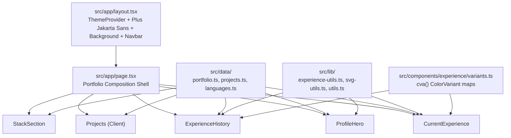

# Architecture

`rb-website` is a single-package Next.js 16 App Router application (`rsc: true`) backed by statically typed TypeScript modules in `src/data/`. There is no runtime database, backend service, or external CMS; all portfolio content compiles cleanly at build time.

## High-Level Structure

## Rendering & Client Boundaries

- **Server Components (default)**: `src/app/layout.tsx`, `src/app/page.tsx`, `ProfileHero`, `CurrentExperience`, `StackSection`, `ExperienceHistory`, `Section*`, and `TechBadge` render on the server without client bundle overhead.
- **Client Components (`'use client'`)**:
  - `Navbar` — listens to `window` scroll events to reveal `ProfileHeader` once `#profile-section` scrolls out of view.
  - `Projects` — manages Radix `Tabs` category filtering (`all`, `frontend`, `backend`, `ai`) and Embla `Carousel` controls.
  - `ThemeProvider` & `ThemeToggle` — wraps `next-themes` (`attribute="class"`, `defaultTheme="system"`, `enableSystem`).
  - `experience-card.tsx` — marked `'use client'`; composes `Card` and `iconVariants` for the current work and education summary cards.
  - Interactive `src/components/ui/*` primitives (`tabs.tsx`, `carousel.tsx`, `dropdown-menu.tsx`).

## Data & Asset Pipeline

- **Type-Safe Registries**:
  - `src/data/languages.ts` defines every supported technology label.
  - `src/data/portfolio.ts` links `workExperience` and `educationExperience` items to `companies` / `universities` via `keyof typeof` and `skills` via `keyof typeof languages`.
  - `src/data/projects.ts` types `githubProjects` against `ProjectCategory`, `ProjectType`, and `keyof typeof languages`.
- **Date Computation (`src/lib/experience-utils.ts`)**:
  - Experience dates are stored as `MM/YYYY` strings (`endDate: null` for ongoing roles).
  - `parseMonthYear`, `formatMonthYear`, and `getExperienceDateText` format localized `pt-BR` strings (`Janeiro de 2023`, `Desde ...`, `Conclusão em ...`) via `date-fns`.
- **SVGR & Images (`next.config.js`)**:
  - Both Webpack and Turbopack transform `*.svg` imports via `@svgr/webpack` with SVGO `removeViewBox: false` so icons scale cleanly via Tailwind `size-*` classes and `svg-utils.ts` fill selectors.
  - External screenshots used by `next/image` (such as `financial-tracker-web-silk.vercel.app`, `github.com`, `ui.shadcn.com`) are allowlisted in `images.remotePatterns`.

## Known Architectural Notes

- `src/app/layout.tsx` currently sets `<html lang="en">` while visible portfolio copy is in Portuguese (`pt-BR`). Keep this in mind if adding localized metadata or multi-language support (`i18n`).
- No automated unit or Playwright test suite is configured yet; correctness is guarded by TypeScript `strict` checking, ESLint (`eslint-config-next` + `eslint-plugin-prettier`), Next.js production builds, and `pnpm docs:check`.
