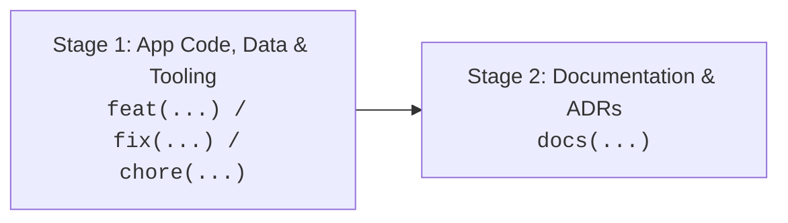

# Commit & Conventional Commit Strategy

This document defines the canonical Git commit conventions, atomic staging approach, pre-commit validation gates, and PR formatting rules for `rb-website`.

---

## 1. Core Principles

1. **Conventional Commits**: Every commit message must follow the [Conventional Commits v1.0.0](https://www.conventionalcommits.org/) specification.
2. **Atomic & Bisect-Safe**: Each commit represents a single, cohesive change. The repository must typecheck, lint, and build cleanly at every commit.
3. **Strict English**: All commit messages, branch names, PR titles, and documentation must be written in English (even when describing Portuguese portfolio copy).
4. **Clear Area Scopes**: Use concise area scopes (`ui`, `data`, `design`, `app`, `root`, `docs`, `docs/adr`, `agents`, `ci`) so history stays easy to scan.

---

## 2. Commit Message Structure

```text
<type>(<scope>): <description>

[optional body]

[optional footer(s)]
```

### 2.1 Grammar & Style Rules

- **Type**: Lowercase, one of the 10 canonical types below.
- **Scope**: Lowercase (`ui`, `ui/projects`, `data`, `design`, `app`, `root`, `docs`, `docs/adr`, `agents`, `skills`, `ci`).
- **Subject / Description**:
  - Use the **imperative mood** (`add`, `fix`, `implement`, `remove`, `update`).
  - Do **not** capitalize the first letter of the description.
  - Do **not** place a trailing period (`.`).
  - Keep the subject concise (under 72 characters when possible).
- **Footer** (optional): Reference ADRs or Linear issues (e.g. `Refs ADR 2026-11-17-01-17-00`, `Refs RIC-12`).

---

## 3. Commit Types Taxonomy

| Type | When to Use | Example |
| :--- | :--- | :--- |
| `feat` | Adding a new section, component capability, or portfolio feature | `feat(ui/projects): add project category filter count` |
| `fix` | Correcting a bug, layout flaw, or data error | `fix(ui/navbar): prevent overflow on 360px viewports` |
| `docs` | Documentation changes, ADR records, README updates | `docs(adr): record ADR 2026-11-17-01-17-00 for agent setup` |
| `chore` | Maintenance tasks, dependency upgrades, agent/tooling config | `chore(root): add docs and branch audit scripts` |
| `refactor` | Code restructuring that neither fixes a bug nor adds a feature | `refactor(ui/experience): extract shared card variants` |
| `test` | Adding, updating, or fixing tests | `test(ui): add smoke specs for experience tabs` |
| `perf` | Changes that improve performance, LCP, or bundle size | `perf(app): optimize hero image priority` |
| `style` | Formatting or visual alignment without logic changes | `style(design): align focus ring contrast in dark mode` |
| `ci` | CI/CD workflows and Dependabot configuration | `ci(github): add lint and build check workflow` |
| `revert` | Reverting a previous commit | `revert: feat(ui/projects): ...` |

---

## 4. Staged Atomic Commit Pipeline

When a task modifies both application code and documentation/ADRs, stage and commit them in separate atomic steps:



---

## 5. Pre-Commit Validation Gates

Enable the versioned pre-commit hook in a checkout with:

```bash
git config core.hooksPath .githooks
```

When markdown files, `package.json`, `scripts/check-docs.py`, or `.githooks/pre-commit` are staged, the hook runs `python3 scripts/check-docs.py`.

### 6. Pre-Commit Validation Gates

| Target Area | Required Validation Command |
| :--- | :--- |
| **Formatting** | `pnpm prettier` |
| **Type Safety** | `pnpm typecheck` |
| **Linting** | `pnpm lint` |
| **Production Build** | `pnpm build` |
| **Documentation & Links** | `pnpm docs:check` |

---

## 7. Branching & Pull Request Conventions

For full branch lifecycle rules, see [Git Branching Strategy & Topic Lifecycle](branching-strategy.md) and [`.agents/skills/git-branching/SKILL.md`](../.agents/skills/git-branching/SKILL.md).

- **Topic Push & `develop` Integration**: Push validated topic branches (`git push -u origin <prefix>/<slug>`) and confirm with the user before `--no-ff` merging into `develop` and pushing `origin/develop`.
- **On-Demand PR Formatting**: Generate PR titles/bodies only when explicitly requested (e.g., Release PR `develop` -> `main`, urgent bypass PR to `main`, or `/pr`):
  - **Title**: `[<Prefix>] <Imperative description>` or `[Release] vX.Y.Z - <Highlights>`.
  - **Body**: Follow the 5-section layout from [`.agents/skills/pr/SKILL.md`](../.agents/skills/pr/SKILL.md) (`## Summary`, `## Evidence`, `## Merge Danger`, `## Verification Gates`, `## References`).
